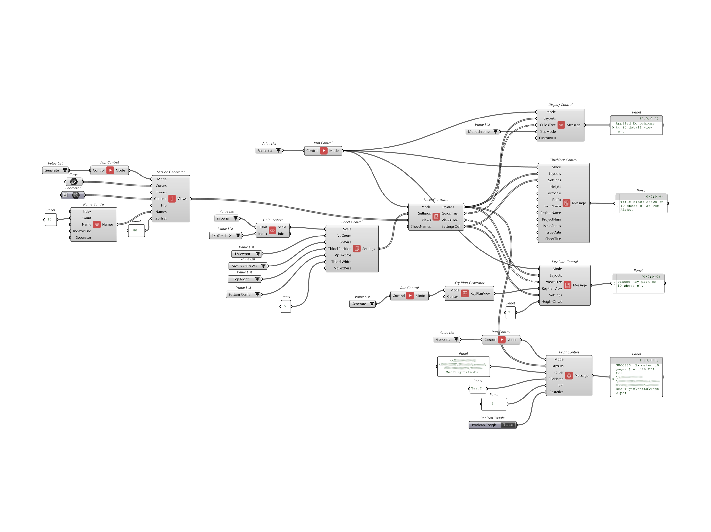

# SectionToolkit

A Grasshopper toolkit for automated structural section documentation in Rhino 8.

SectionToolkit turns model geometry, section curves, or section planes into a
coordinated, scaled sheet set — generating clipping planes and named section
views, laying them out on layout sheets at true architectural scale, and
finishing them with title blocks, key plans, viewport labels, and PDF export.
What is normally a manual, multi-hour drafting task becomes a repeatable,
parametric workflow that updates as the model changes.

## Demo

A 6-minute walkthrough: install, cut sections, generate sheets, add a key plan, and export to PDF.

## Features

- Generate clipping planes and named section views from curves or planes
- Lay out 1–4 views per sheet at a chosen architectural scale
- Automatic, adaptive viewport sizing (no manual dimension entry)
- Title blocks with a full-height information column
- Key plans with per-sheet cut indicators and labels
- Viewport labels (name + scale) with separators
- Display-mode control per sheet or per detail
- PDF export with resolution control

## Requirements

- Rhino 8 (Windows)
- Grasshopper (included with Rhino 8)

## Installation

**Via Rhino Package Manager (recommended)**

1. In Rhino, run the `PackageManager` command.
2. Search for `SectionToolkit`.
3. Click Install and restart Rhino.

**Manual**

1. Download the latest release from the [Releases](../../releases) page.
2. Follow the install steps in [docs/INSTALL.md](docs/INSTALL.md).

## Quick start

1. Open the example file in [`examples/`](examples/).
2. Set the Run Control to **Generate**.
3. Feed section curves (or planes) into **Section View Control**.
4. Configure the sheet layout in **Sheet Control**, then run **Sheet Generator**.
5. Add finishing: **Title Block**, **Key Plan**, **Display Control**.
6. Export with **Print Control**.

See [docs/](docs/) for the full component reference and workflow guide.

## Components

SectionToolkit is organized into families:

- **Setup** — Run Control, Unit & Scale Context, Name Builder, Sheet Control
- **Generators** — Section View Control, Sheet Generator, Key Plan Generator
- **Finishing** — Title Block, Display Control, Key Plan Placer, Print Control

## License

Released under the [MIT License](LICENSE).

Originally developed at HKS, Inc. (LINE — Laboratory for Intensive Exploration).

## Acknowledgements

Inspired by, and grateful to, the open-source Grasshopper community — in
particular [DraftHorse](https://github.com/jkamm/DraftHorse_rh8) and
[PDF+](https://github.com/interopxyz/PdfPlus).
